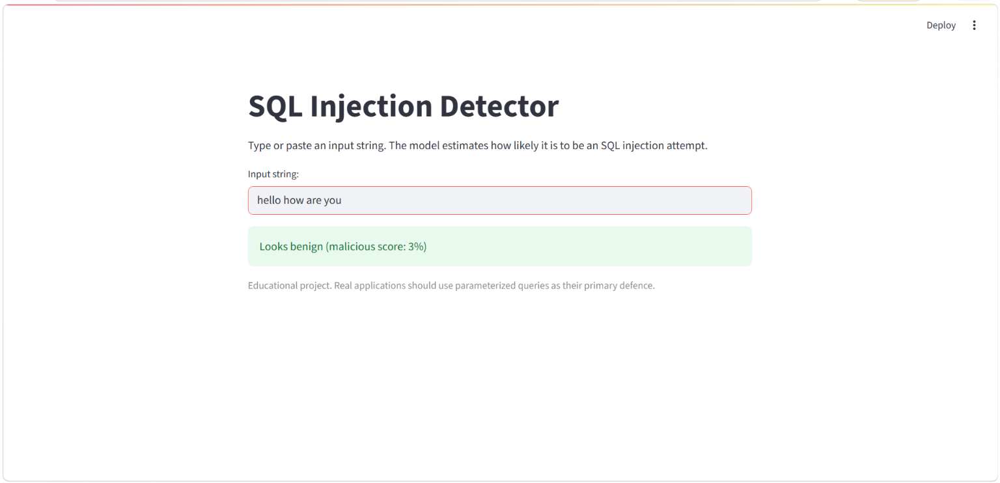
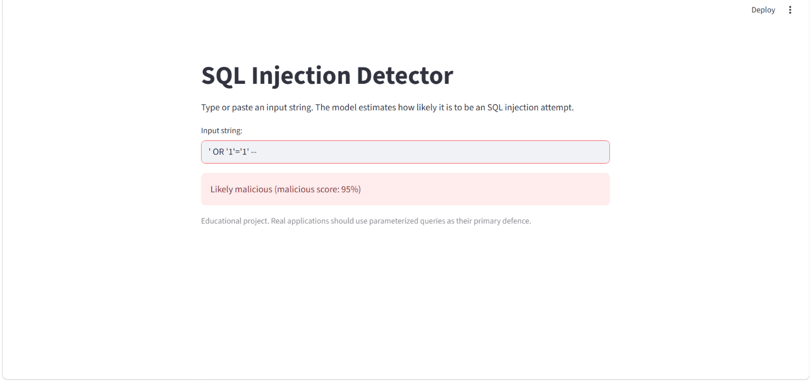
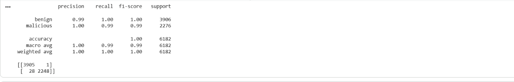
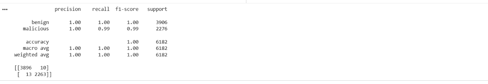
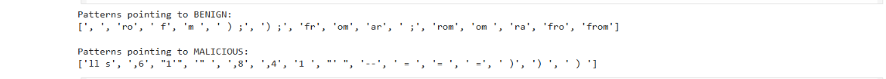
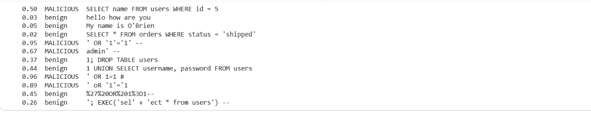
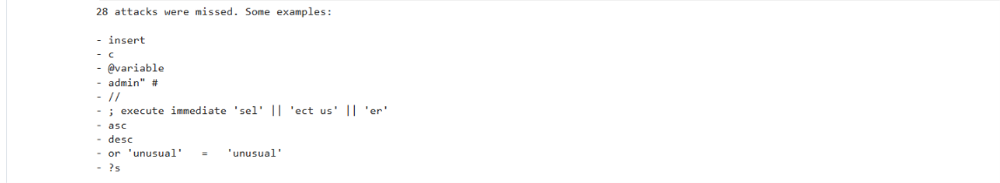

# SQL Injection Detector (ML)

A machine learning model that classifies input strings as **benign** or **SQL injection attempts**, built with TF-IDF character n-grams and Logistic Regression, with a Streamlit demo app.

> Educational project. ML detection is a supporting layer, not a replacement for parameterized queries.

**Author:** Shreya ([@shreya06-art](https://github.com/shreya06-art))

## Demo

| Benign input | Malicious input |
|---|---|
|  |  |

## Problem

SQL injection happens when an attacker inserts SQL code into an input field so that the database runs it. It remains one of the most common web vulnerabilities. This project asks: can a simple ML model learn to recognise injection attempts from the text of the input alone, and where does it fail?

## Dataset

[SQL Injection Dataset](https://www.kaggle.com/datasets/sajid576/sql-injection-dataset) from Kaggle (not included in this repo, so download it from Kaggle if you want to re-run the notebook).

- 30,919 labelled queries, reduced to **30,907** after removing 12 duplicates
- **19,529 benign** (63%) and **11,378 malicious** (37%)
- Duplicates were removed so the same query could not appear in both the training and validation sets

## Approach

1. **Clean:** keep the query and label columns, drop missing values and duplicates.
2. **Split:** 80% training (24,725 rows), 20% validation (6,182 rows), stratified so both parts keep the same 63/37 class mix.
3. **Vectorise:** TF-IDF on character n-grams of length 2 to 4, limited to the 20,000 most useful patterns. Characters are used instead of words because attacks hide in symbols such as `'`, `--` and `=`. The vectoriser is fitted on the training data only, to avoid leakage.
4. **Train two models:** Logistic Regression and Random Forest (100 trees).
5. **Evaluate:** precision, recall and a confusion matrix. Recall on the malicious class matters most, since a missed attack is the costly mistake.
6. **Stress test:** a small set of hand-written queries that are not in the dataset.

## Results (validation set, 6,182 queries)

| Model | Attacks missed | False alarms | Malicious recall | Malicious precision | Accuracy |
|---|---|---|---|---|---|
| Logistic Regression | 28 | 1 | 98.77% | 99.96% | 99.53% |
| Random Forest | 13 | 10 | 99.43% | 99.56% | 99.63% |

The Random Forest misses fewer attacks but raises more false alarms. Both are very strong on this dataset. The demo app uses Logistic Regression because it is fast, small, and its learned weights can be inspected.

**Logistic Regression**



**Random Forest**



## What the model learned

The patterns with the largest weights in Logistic Regression:

- **Pointing to malicious:** `--`, `' `, `1 `, ` = `, `= `, ` )`, `) `, and number runs such as `,4`, `,6`, `,8` (a typical way to probe how many columns a query has)
- **Pointing to benign:** `from`, `rom`, `fr`, `, `, ` ;`, `) ;`



## Where it fails

High validation scores do not mean the model is robust. I wrote 12 queries of my own, 4 normal and 8 attacks:

| Query | Malicious score | Result |
|---|---|---|
| `SELECT name FROM users WHERE id = 5` | 0.50 | False alarm (borderline) |
| `hello how are you` | 0.03 | Correct |
| `My name is O'Brien` | 0.05 | Correct |
| `SELECT * FROM orders WHERE status = 'shipped'` | 0.02 | Correct |
| `' OR '1'='1' --` | 0.95 | Caught |
| `admin' --` | 0.67 | Caught |
| `1; DROP TABLE users` | 0.37 | **Missed** |
| `1 UNION SELECT username, password FROM users` | 0.44 | **Missed** |
| `' OR 1=1 #` | 0.96 | Caught |
| `' oR '1'='1` | 0.89 | Caught |
| `%27%20OR%201%3D1--` (URL-encoded) | 0.45 | **Missed** |
| `'; EXEC('sel' + 'ect * from users') --` | 0.26 | **Missed** |

The model caught 4 of 8 attacks, compared with about 99% on the validation set. The sample is tiny, so this is an illustration, not a precise measurement, but the gap is real.



**Why:** the model partly learned that tidy-looking SQL (`from`, neat endings) means benign. That is a shortcut that fits the dataset's style, and real attackers also write tidy SQL, as the `UNION SELECT` example shows.

**The 28 attacks missed on the validation set** fall into three groups:
- Fragments that are not really attacks (`insert`, `asc`, `@variable`), which suggests some noise in the dataset labels
- Obfuscation, such as splitting `SELECT` into pieces joined with `||`
- Variations of known tricks, such as `#` as the comment marker, or `'unusual' = 'unusual'` instead of `1=1`



## Limitations

- Validation data comes from the same collection as the training data, so scores overstate real-world performance.
- Learns surface patterns, not what a query would actually do. Obfuscated and encoded payloads can slip through.
- The hand-written test set is small (12 queries).
- The decision threshold is fixed at 0.5 and has not been tuned.
- The real defence against SQL injection is parameterized queries and input handling. This model is only an additional signal.

## Future work

- URL-decode input before predicting (a one-line fix for encoded payloads)
- Tune the decision threshold and report the precision/recall trade-off
- Evaluate on a second, independent dataset
- Add cross-validation, and a larger hand-written test set
- Try features that capture query structure, not only character patterns

## Run it locally

```bash
git clone https://github.com/shreya06-art/sql-injection-detector-ml.git
cd sql-injection-detector-ml
pip install -r requirements.txt
streamlit run app.py
```

`requirements.txt` pins `scikit-learn==1.6.1`, the version the model was trained with, because saved models can fail to load under a different version.

## Project structure

```
sql-injection-detector-ml/
├── app.py                  # Streamlit demo
├── sqli_detector.ipynb     # data cleaning, training, evaluation, testing
├── sqli_model.pkl          # trained Logistic Regression model
├── vectorizer.pkl          # fitted TF-IDF vectoriser
├── requirements.txt
├── images/                 # screenshots used in this README
└── .gitignore
```

## Tech

Python, pandas, scikit-learn, Streamlit, joblib